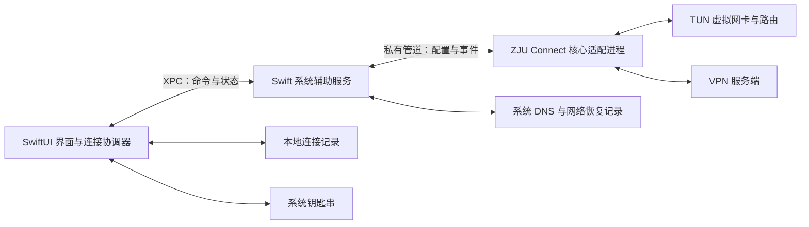

# miniEasyConnect 技术方案

日期：2026-10-25  
依据：[产品方案](产品方案.md)  
实施拆解：[任务清单](任务清单.md)  
状态：核心、界面及辅助服务已实现，实机集成验证进行中；验证结果见[验收记录](验收记录.md)

## 1. 技术方案定义

采用 **SwiftUI 原生界面 + Swift 系统辅助服务 + ZJU Connect 核心适配进程**。保留 TUN 模式，让应用连接后，浏览器、终端等软件直接按 VPN 路由访问授权内网。

主要优化界面和后台运行成本。协议登录、会话和隧道传输继续复用 ZJU Connect，不重新实现一套 VPN 协议。整体内存目标约 50 MB，实际结果以集成后的全部相关进程测量为准。

本方案定义模块职责、连接生命周期、数据保存和网络恢复方式，供后续实现使用。

## 2. 现状与约束

### 2.1 已核实的核心能力

参考 ZJU Connect 提交 `c19eb4ed34b9cf6e8e8ea3315fe9973c8411eb63`。以下是源码事实，不代表 miniEasyConnect 已经具备这些能力：

| 源码位置 | 已确认行为 | 对集成的影响 |
| --- | --- | --- |
| `client/easyconnect/client.go` | 提供客户端构造、登录准备、关闭，以及认证挑战处理接口 | 可以复用协议包并接入原生验证弹窗 |
| `client/authchallenge/types.go` | 定义验证码、图片验证码等交互请求和返回值 | 无需通过终端提示文字识别验证码流程 |
| `stack/tun/stack_darwin.go` | 创建虚拟网卡并提供添加路由能力；可修改系统 DNS | TUN 及系统网络操作需要管理员权限 |
| `internal/hook_func/initial_func_darwin.go` | CLI 初始化会清空网络服务的 DNS；退出钩子将 DNS 设为自动获取 | 不能直接依赖 CLI 的 DNS 恢复行为 |
| `main.go`、`service/dns.go` | CLI 启动多个服务；部分路由和 DNS 错误只记录日志 | 不能仅通过启动成功或日志关键词判断连接成功 |
| `stack/tun/stack.go` | 部分传输错误通过 panic 结束进程；终止钩子具有进程级状态 | 每次完整连接使用独立核心进程，外部负责兜底清理 |
| `client/easyconnect/client.go`、`protocol.go` | HTTP 和隧道 TLS 路径存在跳过证书校验的设置 | 集成版本需要明确证书验证策略 |
| `go.mod`、`LICENSE` | 声明 Go 1.25.6，许可证为 AGPL-3.0 | 固定构建工具链与源码版本，发布时保留许可证和对应源码 |

源码引用见第 10 节。

### 2.2 平台与运行约束

- 只构建 macOS ARM64 版本。最低系统版本暂按 macOS 13 设计，对应 SwiftUI 菜单栏入口和 SMAppService；发布支持范围以实际验证为准。
- 按 GitHub 源码及应用包直接分发设计。界面以普通用户权限运行，系统网络操作由授权后的辅助服务执行。
- 仅保留一个活动连接。核心版本随应用固定，不跟随上游主分支自动升级。
- 优先保证正常连接、后台维持和恢复原网络，再优化资源占用。

## 3. 总体技术思路

### 3.1 模块与状态所有权

| 部分 | 职责与状态所有权 |
| --- | --- |
| SwiftUI 应用 | 界面、连接记录、钥匙串访问；保存用户“保持连接”或“主动断开”的意图，协调重连 |
| Swift 辅助服务 | 管理唯一核心子进程，持有实际会话执行状态；负责系统 DNS、网络变更记录和异常清理 |
| Go 核心适配进程 | 复用认证、资源获取和隧道传输；创建 TUN、安装所需路由、提供 DNS 解析能力及结构化事件 |

UI 显示辅助服务返回的状态，不另行推测“已连接”。正常连接期间预计为三个进程；未连接时不启动 Go 核心，辅助服务按需运行。

关闭窗口不退出 SwiftUI 应用。v1.1 使用 AppKit 管理窗口与原生 `NSStatusItem` 菜单栏入口，连接界面由按需创建的 SwiftUI `NSHostingView` 承载；关闭窗口释放界面内容。菜单栏图标仅启用手动移除能力，并使用 `showMenuBarExtra` 保存显示偏好；手动移除只更新显示偏好，不调用断开或退出流程，应用菜单提供恢复入口。应用进程崩溃时，辅助服务终止本次连接并恢复网络，避免留下无法控制的连接。

### 3.2 核心复用方式

在固定版本的 ZJU Connect 源码基础上维护一个小型 Go 入口，构建为应用内置的核心可执行文件。适配入口留在上游 Go 模块内，能够合法引用其 `internal` 包。

复用 `client/easyconnect`、`underlay`、`stack/tun` 和解析相关包。新增入口只负责配置、事件、认证交互和生命周期编排。绕开原 CLI 的初始化、默认服务启动及全局 DNS 修改逻辑。

需要的有限适配集中在以下边界：

1. 启动就绪、运行失败和退出结果通过结构化事件返回。
2. 认证挑战转发给 SwiftUI，并接收用户输入。
3. 将 TUN 的创建、路由添加和 DNS 修改拆开，由辅助服务统一掌握网络变更。
4. 必要初始化错误明确返回；隧道就绪后才报告准备完成。
5. 将证书验证策略接入 HTTP 和隧道 TLS 两条路径。

这些是计划中的适配，不是上游已经提供的完整 SDK。源码以固定提交和可审查补丁维护；构建产物中记录上游提交和本项目适配版本。

### 3.3 为什么保留 TUN

TUN 是虚拟网卡，使普通应用的网络请求按系统路由进入 VPN。它符合“连接后直接使用”的目标。

本地 HTTP/SOCKS 代理需要应用支持或配置代理，无法等价覆盖当前产品体验，因此不作为本方案的连接方式。也没有证据表明去掉 TUN 就能解决整体内存目标。

路由按服务端授权资源生成，不硬编码内网网段，不自行添加全流量默认路由。若服务端明确要求全流量策略，需在兼容验证时确认其行为，不能承诺所有部署下公网始终直连。

## 4. 功能技术映射

| 编号 | 产品功能 | 行为与负责模块 | 数据与接口 | 异常边界 | 验证点 |
| --- | --- | --- | --- | --- | --- |
| F-01 | 连接记录 | 应用管理新增、选择、修改和删除，提交时只持久化记录，连接由独立入口发起，失败或取消保留记录 | 本地 JSON、钥匙串 | 保存失败不开始连接；部分保存按真实落盘结果同步并提示 | 连接失败后重启记录仍在，明文文件中无密码 |
| F-02 | 内网连接 | 核心负责认证与传输，辅助服务协调网络配置 | XPC 命令、核心事件、服务端资源 | 授权取消、认证失败、资源缺失、TUN 或 DNS 创建失败 | 未单独配置代理的应用可访问授权内网 |
| F-03 | 后台运行与连接状态 | 应用保存连接意图，辅助服务持有执行状态，核心保持会话 | 状态订阅、网络变化事件、认证挑战 | 断网、睡眠唤醒、凭据失效、子进程退出 | 关闭窗口不掉线，主动断开后不自动重连 |
| F-04 | 断开与网络恢复 | 辅助服务监督核心退出并恢复本次网络变更 | 会话标识、恢复记录、停止结果 | 初始化中途失败、退出超时、进程崩溃、网络配置被外部修改 | 恢复原 DNS，清理本次路由，无孤立核心进程 |

## 5. 关键设计

### 5.1 系统授权与进程通信

使用 SMAppService 注册应用内置的 LaunchDaemon，由系统管理辅助服务。首次连接遇到未授权状态时，界面引导完成系统要求的批准；完成后普通连接不再反复要求输入管理员密码。系统撤销授权或升级后的行为需要实机验证。依据：[Apple SMAppService 文档](https://developer.apple.com/documentation/servicemanagement/smappservice)。

应用与辅助服务使用 XPC，双方校验签名身份，辅助服务同时检查请求的用户身份和当前会话归属。只提供连接、停止、提交认证输入和查询状态等固定能力，不暴露任意命令执行接口。依据：[Apple XPC 签名约束接口](https://developer.apple.com/documentation/foundation/nsxpcconnection/setcodesigningrequirement(_:))。

辅助服务只启动应用包内经过验证的核心文件，不接受客户端提供的可执行路径。启动参数通过结构化参数传递，不拼接 Shell 命令。

核心与辅助服务通过私有双向管道传递有版本号的消息：命令包括启动、认证回答、停止；事件包括认证请求、网络准备完成、运行失败和停止完成。每次连接携带独立会话标识，旧会话的延迟事件不得更新新会话。

密码只经钥匙串、进程内存和受控通信传递，不放在命令行、环境变量、临时配置文件或恢复记录中。原始核心日志与结构化事件分离，不把日志当作连接状态协议。

### 5.2 连接记录与凭据

记录保存在应用专属的 Application Support 目录，使用小型 JSON 文件和原子替换写入。无需数据库。

| 字段 | 业务含义 |
| --- | --- |
| `id` | 连接记录的稳定标识，用于关联钥匙串密码 |
| `serverHost`、`serverPort` | 用户输入的 VPN 服务地址与端口 |
| `username` | 登录账号 |
| `credentialRef` | 钥匙串条目标识，不包含密码 |
| `note` | 可选备注，用于列表和菜单栏识别连接，不参与认证或去重 |
| `schemaVersion` | 本地文件格式版本 |

输入支持 HTTPS 地址或主机加端口，规范化后保存；拒绝地址内嵌的用户名、密码、查询参数等不明确输入。账号不擅自转换大小写，密码保持原值。

备注去掉首尾空白后保存，空备注视为未填写。`note` 使用可选字段，旧记录缺少该字段时直接读取，不升级文件格式或迁移凭据。列表优先显示备注并保留地址、端口和账号，菜单栏使用相同显示名；记录去重仍仅依据地址、端口和账号。

统一连接表单调用 `saveConnection`，校验后写入钥匙串和 JSON，更新列表并关闭表单。保存与连接分别执行；保存保持当前会话、最近连接记录和重连意图。修改活动记录时仅同步备注到活动显示及当前请求，保留实际会话的地址、账号与密码。

列表和大图标点击连接时读取已保存记录与钥匙串；失败后的显式重试同样读取该记录的最新保存值。系统授权后的继续连接沿用原请求。

顶部图标读取 UserDefaults 中的 lastUsedConnectionProfileID（最近发起连接的记录标识），从当前记录列表解析后复用已有连接入口；每次实际启动连接时更新，删除对应记录成功后清除。没有可用标识时选择列表第一条，没有记录时打开新建表单。该偏好只保存记录标识，不保存密码。

连接失败时提供“修改连接”，重新打开已保存的地址、账号和密码；当前请求的密码可从内存预填，其他记录从钥匙串读取。取消编辑不修改记录，也不提交认证。

密码使用系统钥匙串的通用密码条目，仅由应用读取，不启用跨设备同步。钥匙串访问被系统拒绝或锁定时，明确提示用户处理，不降级为明文保存。

JSON 与钥匙串不存在跨存储事务。保存时先创建新凭据条目，再原子写入记录；成功后清理旧凭据，失败时回收新条目。钥匙串或 JSON 保存失败时保持编辑框并提示，不启动新连接。旧凭据清理失败时保留已落盘的新记录和新密码，同步其真实记录标识，避免重新提交时重复新建或回退旧凭据。连接成功回调只更新连接状态，不承担第二次保存。删除记录时一并删除对应凭据，失败则保留可重试状态。

### 5.3 连接生命周期

| 状态 | 业务含义及主要转移 |
| --- | --- |
| 未连接 | 没有活动会话，点击大图标或“+”新建，点击记录中的连接按钮使用已有记录 |
| 等待授权 | 系统辅助服务尚未获得批准；批准后继续，取消后回到未连接 |
| 连接中 | 正在登录、创建隧道和配置网络 |
| 等待验证 | 服务端要求验证码；提交后继续，取消则清理本次连接 |
| 已连接 | 认证、隧道、必要路由和 DNS 均已准备完成，并通过连接就绪检查 |
| 恢复中 | 用户仍希望连接，正在等待网络或重新建立会话 |
| 断开中 | 正在终止核心并恢复网络；完成前不启动另一会话 |
| 连接失败 | 连接无法继续，提供原因与重试入口；若清理失败，同时说明网络恢复尚未完成 |

连接顺序：

1. 应用读取记录和密码，确认辅助服务可用。
2. 辅助服务检查是否存在活动会话或未完成恢复，建立本次恢复记录。
3. 核心完成认证并获取资源，创建 TUN，检查必需资源和路由是否有效。
4. DNS 服务就绪后，辅助服务应用 DNS 配置。
5. 检查隧道、路由和实际 DNS 请求路径，确认后发布“已连接”。

连接就绪检查证明网络通道具备使用条件，不等于所有业务服务均可用。产品验收仍需实际访问授权测试服务；应用不内置任何组织的测试地址，也不扫描内网。

首次完整建连暂定 60 秒超时，不计用户等待授权或输入验证码的时间；停止暂定 10 秒清理期限。数值属于实现初始配置，依据实机结果调整。初始化任一必要步骤失败，都进入同一清理流程。

### 5.4 路由、DNS 与恢复

**路由由核心安装，变更由辅助服务跟踪。** 核心从服务端资源计算路由，逐项检查添加结果。修改前记录计划、原有状态和本次 TUN 标识，修改后记录结果；恢复时只处理本次创建或替换的项。VPN 服务端连接通过物理网络出口建立，避免被自身隧道路由套回。

macOS 上核心发起的隧道内 TCP/UDP 请求同时绑定虚拟源地址和 TUN 接口；通过 `IP_BOUND_IF` 选择接口，绑定失败直接返回错误。

**系统 DNS 由辅助服务统一管理。** 核心适配入口不运行原 CLI 的 DNS 初始化钩子，创建 TUN 时关闭上游自动修改系统 DNS 的行为。DNS 采用 VPN 优先模式，不把 Rcs 授权资源或 `Dns.data` 静态映射键当作完整的 DNS 域名清单；未出现在这些资源中的名称仍可能由 VPN DNS 解析。

本地 DNS 入口在 `127.0.0.1` 分配不低于 1024 的随机空闲 TCP 端口，UDP 使用同一端口；不占用 53 端口，不主动设置端口复用。双协议监听和实际隧道 DNS 请求均成功后，辅助服务才发布系统解析配置；监听或探测失败则清理本次连接并报告失败。

辅助服务通过 `SCDynamicStore` 发布会话级临时 supplemental resolver，地址为私有回环入口，端口来自核心，`SupplementalMatchDomains` 为 `[""]`，使普通系统解析优先使用 VPN DNS。更具体的既有 supplemental resolver 和 mDNS 仍由 macOS 按系统规则处理。原有 `SCNetworkPreferences` DNS 和搜索域不变；核心不截获其他 DNS 流量，自行指定 DNS 的程序不经此入口。

本地 DNS 先使用服务端 `Dns.data` 的名称到 IP 静态映射，未命中时查询服务端下发的全部可用 IPv4 DNS，按配置顺序去重，并为全部上游准备隧道路由和端口资源。单次请求总预算为八秒，按剩余服务器数均分剩余时间；每台先使用不超过三秒且不超过本台预算一半的 UDP，失败或响应截断后使用本台剩余预算尝试 TCP，传输失败再尝试下一台。有效回答保留原始结果，包括不存在的域名和服务端解析失败，不回退公共解析器。

DNS 查询可能经过 VPN，业务流量仍按服务端授权资源和路由处理；解析成功不会自动扩大访问授权。仅对匹配授权域名的 A 记录建立有界映射和必要的动态路由，并在返回响应前等待辅助服务确认。动态路由和 DNS 地址映射分别限制为 4096 项，并发 DNS 请求限制为 64 个。

厂商客户端支持首选 DNS 模式，但现有证据不足以确定 `filter=(null)` 和 `DnsRuleExceptions` 的语义。本实现依据已确认的服务端 DNS 配置提供 VPN 优先解析，不宣称精确复刻厂商 DNS 策略。

恢复记录只包含本机网络变更所需信息，存放在辅助服务专属、受访问限制的目录中，不进入项目目录。辅助服务在发布临时 resolver 前记录会话所有权，并持有对应动态存储会话；断开时仅移除本次 resolver，系统写入或移除失败明确报告。动态存储会话结束后，系统会撤回临时项。旧版本修改网络服务 DNS 所留下的恢复记录仍按原字段所有权规则处理，保留外部后续修改。

正常停止时先停止重连，撤回本次临时 resolver，再关闭核心、清理残留路由并检查恢复结果。核心异常退出时，由辅助服务执行相同恢复流程；超过停止期限可终止本次核心进程，但仍必须完成外部清理。辅助服务重启时先处理未完成恢复，再接受新连接。当前 VPN DNS 优先实现已通过真实内外网访问、窗口关闭及退出清理验证；既有更具体解析器共存仍待专项验证，详见验收记录。

Cmd+Q 同样等待完整断开结果；已有 XPC 连接时，不根据界面的旧状态跳过确认。核心退出、输出收尾和网络恢复成功后才允许 App 完成退出。最后一个 XPC 客户端离开时，辅助服务确认没有核心且网络已恢复，立即退出。恢复失败时保留处理能力并提示失败，不误报退出完成；后台服务注册继续保留，以复用系统批准。

### 5.5 后台保持与重连

应用通过 `applicationShouldTerminateAfterLastWindowClosed` 返回 `false` 保持后台生命周期，不依赖菜单栏图标是否显示。窗口关闭时停止不必要的界面刷新，状态通过事件推送更新。

复用核心的会话保活和短暂传输重试。只有确认核心已经失败或网络出口变化需要重建时，应用才触发完整重连，避免两个层级同时反复创建连接。

网络断开时进入等待状态；网络恢复、物理出口改变或电脑唤醒后，先清理旧会话再重建连接。唤醒后不把核心进程仍存活当作旧 TCP/TLS 会话仍可用的证明。重试间隔逐步增加，最多连续自动尝试四次，失败后提供手动重试。连接连续稳定至少 30 秒后，离开已连接状态时才恢复自动重试预算；短暂连接成功或重复收到已连接状态不会清零次数。稳定时长使用系统单调时钟计算，不增加轮询定时器；用户主动连接或手动重试时重新开始计数。

密码错误、账号锁定、额外验证、授权被撤销属于需要用户处理的情况，不自动循环提交凭据。服务端明确返回账号防暴力破解锁定码 20020 时，单独提示等待解锁或联系管理员，不把锁定合并为普通密码错误。用户主动断开或退出时立即清除“保持连接”的意图。

### 5.6 证书与错误信息

发送账号密码前先完成无凭据 TLS 探测，默认使用系统信任链和主机名验证，同时覆盖登录 HTTP、Token 与隧道 TLS。

对于系统无法验证的私有证书，提供一次明确的证书指纹确认。只有用户点击信任后，应用才按地址与端口保存该叶证书的 SHA-256 指纹，并继续登录；后续连接必须匹配这一指纹。证书改变时重新确认，不接受任意证书，也不在每次普通连接时重复询问。指纹保存在本机 UserDefaults 中，连接密码仍只存钥匙串。

界面只保留必要错误：授权未完成、地址不可达、认证失败、需要验证、网络配置失败和连接中断。原始响应、密码、会话标识、资源清单和解析记录不直接进入界面或持久化日志。

默认不持久化核心原始日志。为判断流程保留少量有界、脱敏的状态事件；错误码与会话序号用于本机排查，不记录真实连接参数。

## 6. 资源控制

| 项目 | 控制方式 |
| --- | --- |
| 界面 | SwiftUI 原生窗口和菜单栏，无网页运行时；仅在状态变化时更新 |
| 核心 | 固定 ARM64 构建，仅启动本产品需要的连接、TUN 和 DNS 能力 |
| 辅助服务 | 按需启动，空闲时不轮询；无活动会话时允许退出 |
| 数据 | 小型连接记录；状态事件和 DNS 缓存设置上限，避免长期增长 |
| 后台活动 | 使用网络变化通知和既有保活机制，不高频抓取进程状态或测速 |

先保持三个模块的职责清晰。若整体内存超标，通过实际测量确定占用来源，再决定是否压缩缓存、调整 Go 运行时或合并进程。

资源比较使用同一台设备、同一连接和相近流量，分别记录启动峰值、窗口打开、窗口关闭后稳定空闲以及持续传输场景。统计 UI、辅助服务和核心的总量，报告明确使用 RSS 还是 physical footprint；不同口径不直接比较。100 MB 按十进制记录，使用 MiB 的工具结果应换算并注明。

## 7. 构建、分发与公开资料

应用、辅助服务和核心一起构建为 ARM64 应用包。核心固定 Go 工具链、上游提交和适配补丁，应用与核心版本一并展示在构建信息中。升级时先结束连接，再替换完整应用包，避免新旧辅助服务与核心协议混用。

面向普通用户分发的应用包计划使用 Developer ID 签名并公证；发布前需确认签名身份、辅助服务注册、更新和卸载路径。仅发布源码与分发可直接运行的应用包具有不同准备成本，当前不假设签名证书已具备。依据：[Apple 应用签名与公证说明](https://developer.apple.com/documentation/security/notarizing-macos-software-before-distribution)。

构建脚本根据辅助服务实际签名的证书类型选择时间戳，支持按名称或哈希指定身份。Apple Development 使用 `--timestamp=none`；Developer ID Application 对应用、辅助服务和核心均使用安全时间戳 `--timestamp`，需要访问 Apple 时间戳服务。脚本只完成签名和包校验，公证状态单独确认。依据：[Apple 分发签名说明](https://developer.apple.com/documentation/xcode/creating-distribution-signed-code-for-the-mac)。

本项目采用 AGPL-3.0，并保留 ZJU Connect 版权、许可、对应源码及构建资料。源码发布包含修改后的核心。应用图标采用 Tabler Icons 的 MIT 许可网络图形，来源和原许可保存在 Resources/ThirdParty。依据：[上游 LICENSE](https://github.com/Mythologyli/zju-connect/blob/c19eb4ed34b9cf6e8e8ea3315fe9973c8411eb63/LICENSE)。

公开仓库只包含代码、文档、虚构示例和构建说明。真实连接记录、网络恢复文件、凭据、签名材料、原始日志和抓包不进入版本库。所有文档、截图及验证报告沿用产品方案的脱敏要求。

## 8. 主要风险与验证方式

| 事项 | 风险与验证重点 |
| --- | --- |
| 权限和应用生命周期 | 验证首次批准、取消、撤销、重新启动、升级后授权及辅助服务身份校验 |
| 核心适配 | 编译 ARM64 核心，运行相关现有测试；验证结构化事件与真实进程退出一致 |
| 内网访问 | 在授权环境验证浏览器和终端直接访问，覆盖 IP、域名及实际需要的 TCP/UDP；不把 DNS 成功等同于业务成功 |
| 网络恢复 | 对比连接前后 DNS、路由；覆盖原静态 DNS、原自动 DNS、启动失败、核心崩溃和辅助服务恢复 |
| 后台稳定性 | 覆盖窗口关闭、短暂断网、网络切换和睡眠唤醒；确认主动断开不再自动连接 |
| 凭据和验证 | 检查密码更新、钥匙串访问失败、验证码取消；检查进程参数及公开产物中无秘密 |
| 协议兼容范围 | 当前方案面向 EasyConnect 的 TUN 能力；IPv6 内网、仅 TCP 隧道和未接入的验证方式不得未经验证宣称支持 |
| 资源目标 | 记录全部相关进程的稳定占用和峰值，并与同条件客户端对比；持续运行观察是否增长 |

验证以编译、相关现有测试和人工实机验收为主，本方案不要求新增测试类。系统网络变更必须保留脱敏后的人工核对结果。

优先验证完整纵向路径：系统批准 → 登录 → TUN 与 DNS 就绪 → 实际访问 → 关闭窗口保持 → 断开恢复。该路径成立后再完善记录管理、重连边界和资源优化。

## 9. 实施前需要落实的条件

1. **核心集成验证**：认证交互、启动就绪、DNS 错误、TLS 校验和停止清理均涉及适配，不能以原 CLI 可以运行代替完整验证。
2. **发布准备**：确定正式应用标识、签名方式和项目许可证；这些影响可分发应用包，不影响当前文档设计。
3. **兼容与资源基线**：确认支持的系统版本、授权测试环境和资源测量口径，再给出已验证的兼容范围与内存数字。

## 10. 源码与文档依据

以下源码链接固定到本次检查的公开提交，避免上游后续修改导致结论混淆：

- [EasyConnect 客户端与认证入口](https://github.com/Mythologyli/zju-connect/blob/c19eb4ed34b9cf6e8e8ea3315fe9973c8411eb63/client/easyconnect/client.go)
- [认证挑战接口](https://github.com/Mythologyli/zju-connect/blob/c19eb4ed34b9cf6e8e8ea3315fe9973c8411eb63/client/authchallenge/types.go)
- [macOS TUN 与路由](https://github.com/Mythologyli/zju-connect/blob/c19eb4ed34b9cf6e8e8ea3315fe9973c8411eb63/stack/tun/stack_darwin.go)
- [macOS 初始化与 DNS 钩子](https://github.com/Mythologyli/zju-connect/blob/c19eb4ed34b9cf6e8e8ea3315fe9973c8411eb63/internal/hook_func/initial_func_darwin.go)
- [CLI 启动流程](https://github.com/Mythologyli/zju-connect/blob/c19eb4ed34b9cf6e8e8ea3315fe9973c8411eb63/main.go)
- [DNS 服务](https://github.com/Mythologyli/zju-connect/blob/c19eb4ed34b9cf6e8e8ea3315fe9973c8411eb63/service/dns.go)
- [隧道运行与错误处理](https://github.com/Mythologyli/zju-connect/blob/c19eb4ed34b9cf6e8e8ea3315fe9973c8411eb63/stack/tun/stack.go)
- [隧道 TLS](https://github.com/Mythologyli/zju-connect/blob/c19eb4ed34b9cf6e8e8ea3315fe9973c8411eb63/client/easyconnect/protocol.go)
